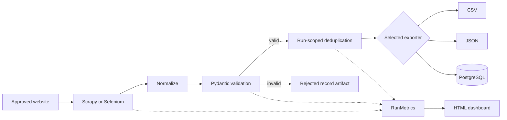

# Architecture

The system separates acquisition from data quality and persistence. Both engines emit raw dictionaries at one boundary; the shared pipeline turns them into validated `BookRecord` or `QuoteRecord` instances. Typed records then travel through exporters and reporting.

## Components and data flow

1. **Settings and CLI** validate configuration before launching scrapers. Options override `.env`/environment settings. The `all` command runs sources sequentially, exporting separate datasets and reporting both runs.
2. **Scrapy** follows catalogue pagination and product-detail links. One concurrent request and a configurable delay keep demo-site traffic polite. Product details supply category and availability. Scrapy runs in a subprocess so repeated CLI/library invocations do not restart a Twisted reactor.
3. **Selenium** renders quote pages using explicit DOM waits. BeautifulSoup parses the rendered page source through a separately testable function. Pagination checks the approved domain/path and detects cycles. Browser cleanup is in a `finally` block.
4. **Normalization and validation** parse exact Decimal prices, map ratings/currencies, normalize Unicode whitespace and HTTP URLs, and validate required fields. Pydantic text validators perform final normalization before acceptance. Invalid inputs increment a counter and retain a useful rejection reason without aborting a run.
5. **Deduplication** uses SHA-256 of JSON-encoded identity tuples: `(source, product_url)` for books, `(quote, author)` for quotes. It is scoped to one run. PostgreSQL reuses these identifiers across runs for idempotent upserts.
6. **Exporters** accept typed records. CSV has fixed per-kind columns; JSON retains exact prices as strings. Both use temporary-file writes followed by atomic replacement. PostgreSQL uses one transaction for records and the final run snapshot.
7. **Reporting** consumes records and `RunMetrics`. It produces a portable HTML document with escaped text, actual counters, sample records, and failure details. Run JSON and rejection artifacts remain available even when HTML rendering fails.

## Key decisions

| Decision | Reason |
|---|---|
| Separate scraping engines | Static pages need HTTP parsing; JavaScript pages require rendering. |
| Shared processing boundary | Both sources get the same rejection accounting and identity rules. |
| Decimal prices | Prevent binary floating-point changes during export and database roundtrips. |
| Stable IDs | Deduplication and repeatable database updates do not depend on run timestamps. |
| Explicit SQLAlchemy tables | Small, visible schema with useful indexes and constraints; migrations can be added later. |
| Self-contained report | The delivered artifact remains readable offline without external assets. |
| Bounded in-memory runs | Keeps the demo maintainable; streaming is a future extension for larger workloads. |

No throughput or memory benchmark is claimed. Scrapy's request concurrency is deliberately set to one.

## Failure and resource handling

Validation failures are rejected records, not retry candidates. Scrapy handles bounded HTTP/network retries. Selenium retries timeouts and selected network failures, but not selector/programming errors. PostgreSQL retries transient connection/serialization failures using idempotent transactions. Failed requests or exceptions result in failed run metrics and a nonzero CLI exit; valid partial records may still be exported.

Database connections close through context managers and engines are disposed in `finally`. Browser shutdown also uses `finally`. If a database is unavailable, the run can still be diagnosed through local metrics; it cannot persist a failed-run row into the unavailable database. Error messages from database/browser exceptions are summarized by exception type to avoid putting credentials into artifacts.

The report and latest-run metrics use fixed paths. Do not run multiple commands from the same working directory concurrently when preserving every run matters. Record-file exports are atomic, but the application is not a multi-process job scheduler.

## Database and extensions

Tables: `books`, `quotes`, `scrape_runs`. Record IDs and run IDs are primary keys. Category, author, and source columns have lookup indexes; book price/rating constraints protect stored data. Existing records are updated to the latest observed values. There is no historical per-field versioning or schema migration system yet.

To extend the system, introduce an approved source adapter with offline HTML fixtures, define its model and identity, then extend exporter dispatch and report rendering. New formats should accept typed records and preserve explicit failure behavior.
