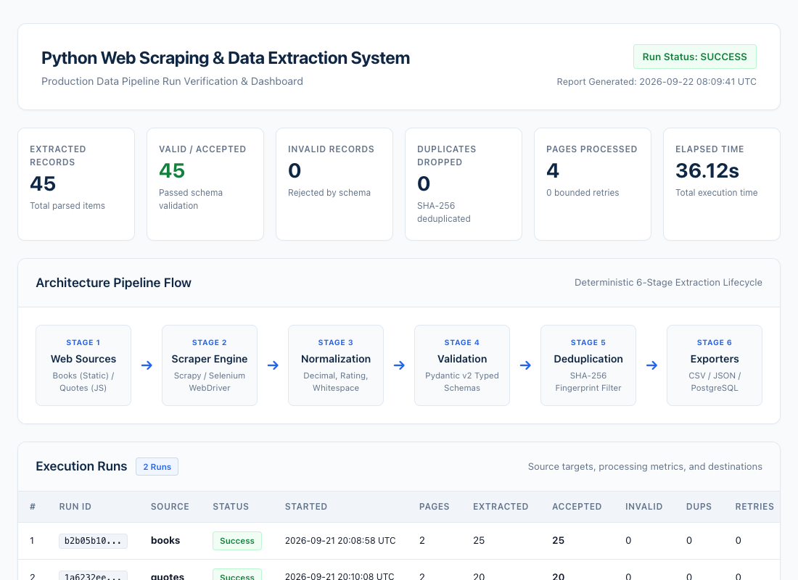
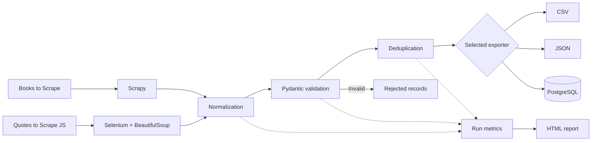

# Python Web Scraping & Data Extraction System

A production-style data extraction pipeline demonstrating static and JavaScript-rendered web scraping, validation, normalization, deduplication, multiple export formats, PostgreSQL persistence, automated testing, and run reporting.



## 1. Overview

Two approved public demo websites feed the same typed processing pipeline. Scrapy extracts catalogue and product details from **Books to Scrape**. Selenium renders **Quotes to Scrape JS**, and BeautifulSoup parses the resulting DOM. The application records what was accepted, rejected, duplicated, or failed, and generates an offline HTML dashboard.

This is an independent engineering project, not a commissioned client engagement. The included samples are actual demo-site extractions. See [verification evidence](docs/VERIFICATION.md) for executed checks and environment limitations.

## 2. Features

- Bounded pagination, accepted-item limits, polite request pacing, and transient retries.
- Validated Pydantic models with Decimal prices, timezone-aware timestamps, and stable identities.
- Shared normalization, validation, and run-scoped deduplication.
- UTF-8 CSV, pretty JSON, and transactional PostgreSQL upserts.
- Atomic file exports, failed-run metrics, rejection records, and structured JSON logs.
- Headless/local or remote Selenium, explicit waits, and browser cleanup.
- Fixture-based tests, Ruff checks, CI, Docker configuration, and a self-contained dashboard.

## 3. Architecture



Read [ARCHITECTURE.md](ARCHITECTURE.md) for contracts, lifecycle decisions, and extension points.

## 4. Tech Stack

| Concern | Implementation |
|---|---|
| Language | Python 3.12+ |
| Static / browser scraping | Scrapy 2.19+, Selenium 4, BeautifulSoup4 |
| Typed records / configuration | Pydantic v2, pydantic-settings |
| Persistence | SQLAlchemy 2, psycopg 3, PostgreSQL |
| CLI / quality | Typer, pytest, Ruff |
| Deployment / reporting | Docker Compose, embedded HTML/CSS |

## 5. Quick Start

Open the repository directory after cloning or downloading it, then:

```bash
python3 -m venv .venv
source .venv/bin/activate
python -m pip install -e '.[dev]'
python -m scraping_system.cli --help
python -m scraping_system.cli books --max-pages 1 --max-items 5 --format json
```

Windows: activate with `.venv\Scripts\Activate.ps1`. Install Google Chrome to run the quotes scraper. Docker is optional for PostgreSQL. Network access is needed for dependency installation, live scraping, and the initial matching driver download.

For the exact dependency versions used in local QA, install `requirements-tested.txt` before the editable installation. The tested environment was Python 3.13 on macOS; CI targets Python 3.12 and 3.13. The project includes CI configuration but does not claim a hosted CI run has occurred.

## 6. Scraping Books

```bash
python -m scraping_system.cli books --max-pages 2 --format json
python -m scraping_system.cli books --max-pages 2 --max-items 25 --format csv --output artifacts/books.csv --generate-report
```

`--max-pages` counts catalogue pages, not product-detail requests. Each catalogue page contains up to 20 books. Product pages supply categories and availability. The crawler uses one concurrent request and defaults to a one-second delay. Output ordering is stable by record identity; scrape timestamps vary between runs.

## 7. Scraping JavaScript Content

```bash
python -m scraping_system.cli quotes --max-pages 2 --format json --headless
python -m scraping_system.cli quotes --max-items 15 --delay 1.5 --format json
```

Selenium Manager discovers Chrome and its driver. Optional environment settings are `SCRAPING_BROWSER_BINARY` and `SCRAPING_SELENIUM_URL`; these are not CLI flags.

If an outdated ChromeDriver on PATH conflicts with your installed Chrome, let Selenium Manager select a matching driver without deleting the system driver:

```bash
SE_SKIP_DRIVER_IN_PATH=true python -m scraping_system.cli quotes --max-pages 1 --headless
```

For a remote Selenium endpoint, set `SCRAPING_SELENIUM_URL=http://localhost:4444`. The supplied Dockerfile installs Chromium and its matching packaged driver.

## 8. Export Formats

| Format | Default destination | Behavior |
|---|---|---|
| CSV | `artifacts/<source>.csv` | Predictable headers, UTF-8, proper quoting; tags are JSON arrays inside cells |
| JSON | `artifacts/<source>.json` | Array of objects; prices are exact decimal strings; timestamps use ISO 8601 |
| PostgreSQL | Configured database | Stable-key upserts into `books`, `quotes`, and `scrape_runs` |

One format is selected per invocation. CSV prefixes potentially executable spreadsheet formulas with an apostrophe; JSON preserves the original validated text. File exports replace their destination atomically. Failed scrapes may export partial records, with a failed status and nonzero exit code. Review the associated run metrics before consuming a partial dataset.

```bash
python -m scraping_system.cli all --format csv --max-pages 1 --output artifacts/both
```

For `all`, `--output` is a directory containing separate books and quotes files. For one source, it is a file path.

## 9. PostgreSQL

Copy `.env.example` to `.env`. Set your own `POSTGRES_PASSWORD` and `SCRAPING_DATABASE_URL`; no working credentials are shipped. Defaults are user `scraper`, database `scraping`. The host connection URL has this shape:

```text
postgresql+psycopg://scraper:<URL-encoded-password>@localhost:5432/scraping
```

```bash
cp .env.example .env
# Edit .env before starting the database.
docker compose up -d postgres
python -m scraping_system.cli books --format postgres --max-pages 1
python scripts/verify_postgres.py
```

The verification script inserts the real sample data twice, checks idempotence and exact prices, and writes `artifacts/postgres_verification.json`. Use a dedicated test database for it. It does not delete existing tables or records.

Tables are created automatically; schema migrations for future changes are not implemented. Upserts preserve one current row per book/quote and one row per run ID. Credentials are excluded from logs and run artifacts.

## 10. Docker

The application image runs as a non-root user. Its entrypoint is already the CLI:

```bash
docker compose build scraper
docker compose run --rm scraper books --max-pages 1 --format json
docker compose run --rm scraper all --max-pages 1 --format csv
```

The Compose scraper service requires `.env`. For database export from inside the container, use hostname **postgres** rather than localhost in `SCRAPING_DATABASE_URL`, then:

```bash
docker compose up -d postgres
docker compose run --rm scraper books --max-pages 1 --format postgres
```

Outputs are bind-mounted to `artifacts/`; ensure that directory is writable by container UID 10001 on Linux. Docker build/startup could not be executed on the development host because Docker was unavailable. PostgreSQL exports were verified separately against a temporary native PostgreSQL instance. Browser sandbox support can depend on the Docker host; use a configured remote Selenium service if the host restricts Chromium's sandbox.

## 11. CLI Reference

```text
python -m scraping_system.cli [OPTIONS] {books|quotes|all}

--format csv|json|postgres             Default: json
--output PATH                         File, or directory for all
--max-pages INTEGER                   Default: 2; catalogue/quote pages
--max-items INTEGER                   Accepted unique records per source
--delay FLOAT                         Default: 1.0 seconds
--headless / --no-headless             Default: headless
--generate-report / --no-generate-report  Default: generate report
--log-level DEBUG|INFO|WARNING|ERROR    Default: INFO
```

CLI options override environment settings. `.env` and environment keys use the `SCRAPING_` prefix; see [.env.example](.env.example). `SCRAPING_TIMEOUT` defaults to 30 seconds and `SCRAPING_RETRIES` to 2. PostgreSQL uses its own bounded transaction retries. Exit codes: 0 success, 1 failed scrape/export/report, 2 invalid configuration/arguments, 130 interruption.

Each invocation writes `artifacts/<source>_run.json` and `artifacts/<source>_rejected_records.json`. These files describe the latest run per source, and the report describes the current invocation. Use unique output paths when archiving runs; simultaneous invocations should run in separate working directories to avoid overwriting these latest-run artifacts.

## 12. Testing

```bash
pytest
ruff check .
ruff format --check .
```

Tests use fixtures and browser mocks. They exercise actual exporters, Scrapy callbacks, normalization, validation, settings, deduplication, browser cleanup, CLI failures, and report escaping. Separate live smoke commands:

```bash
python -m scraping_system.cli books --max-pages 1 --max-items 3 --format json
python -m scraping_system.cli quotes --max-pages 1 --max-items 3 --format json --headless
```

## 13. HTML Run Report

Open [artifacts/report.html](artifacts/report.html) in a browser. It contains real counts, run status, elapsed time, source details, sample tables, and pipeline documentation. Styles are embedded and work offline. No server or CDN is required.

To restore the combined project dashboard after running other commands:

```bash
python scripts/build_sample_report.py
```

This uses saved live-run snapshots from `sample_output/`, not invented metrics.

## 14. Example Output

- [Books CSV](sample_output/books_sample.csv) and [Books JSON](sample_output/books_sample.json): 25 records from two catalogue pages.
- [Quotes JSON](sample_output/quotes_sample.json): 20 records from two rendered pages.
- [Books run](sample_output/books_run.json) and [quotes run](sample_output/quotes_run.json): the corresponding provenance and metrics.

## 15. Project Structure

```text
src/scraping_system/
  cli.py, config.py
  models/        # Typed records and metrics
  spiders/       # Scrapy callbacks and isolated reactor worker
  selenium/      # Browser lifecycle and rendered DOM parser
  pipelines/     # Normalization, validation, deduplication
  exporters/     # CSV, JSON, PostgreSQL
  database/      # SQLAlchemy schema and connection handling
  reporting/     # Self-contained HTML dashboard
  utils/         # Atomic file writes and structured logging
tests/           # Offline regression tests and HTML fixtures
scripts/         # Sample report rebuild and database verification
docs/            # Verification and screenshot tooling
sample_output/   # Real demo records and matching run snapshots
artifacts/       # Dashboard, screenshots, latest run outputs
```

## 16. Screenshots

Four 1100 × 800 images are in [artifacts/screenshots](artifacts/screenshots/): report overview, architecture, real dataset, and actual code. Regenerate with:

```bash
python scripts/build_sample_report.py
python docs/generate_screenshots.py
```

These are browser captures. The report image captures the actual dashboard; the other views are generated from the architecture, saved dataset, and repository source. See [capture instructions](docs/SCREENSHOTS.md).

## 17. Ethical Scraping

Only the public **Books to Scrape** and **Quotes to Scrape JS** testing sites are used. Scrapy obeys robots.txt; both engines have bounded pagination and polite delays. This project does not bypass authentication, CAPTCHAs, anti-bot systems, or access controls, and does not collect private personal data. Adding another target requires reviewing its permission, terms, and rate limits first.

## 18. Extension Ideas

Add schema migrations, a streaming exporter for larger datasets, incremental refresh scheduling, or new explicitly authorized demo targets with their own fixtures. Current runs retain accepted/rejected records in memory; this is appropriate for bounded demo workloads, not an unbounded crawl.
